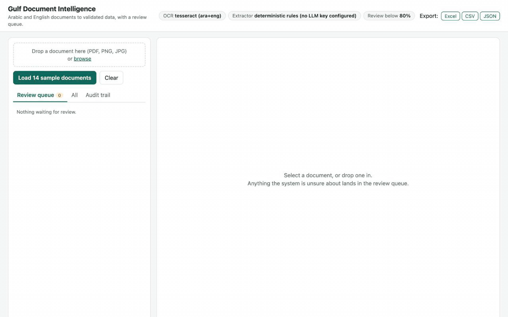
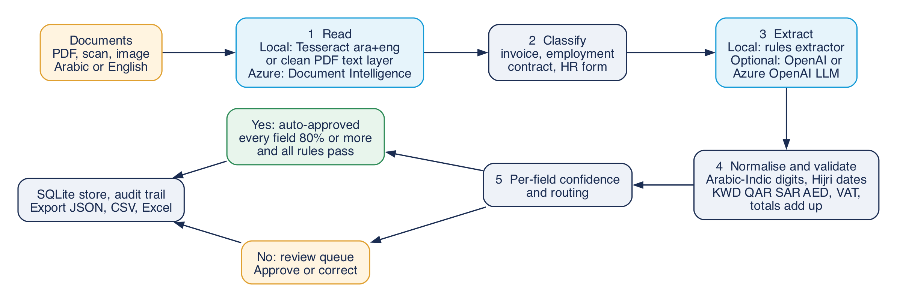
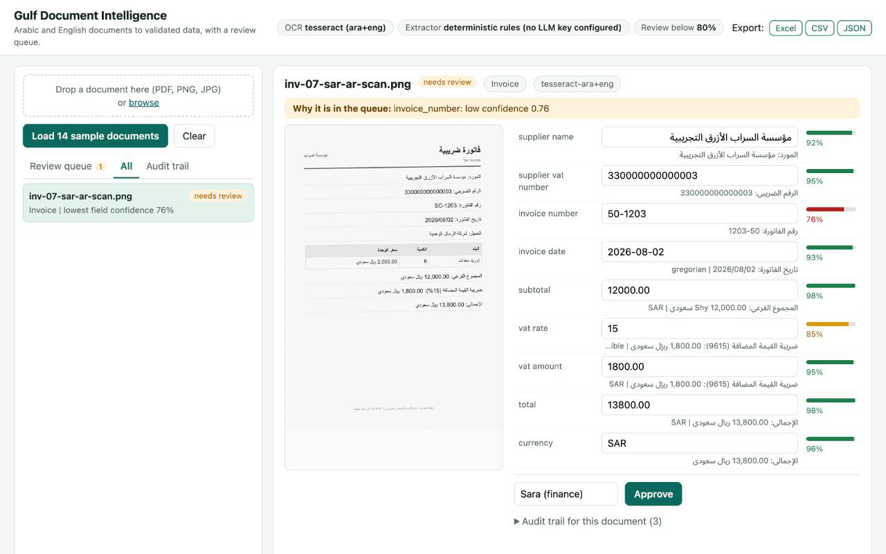
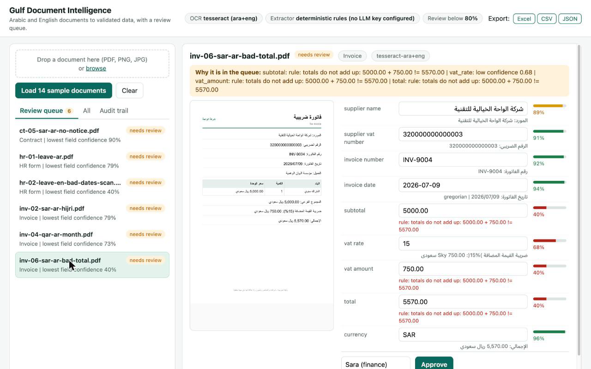

# Arabic document intelligence (Gulf edition)

**Arabic and English contracts, invoices and HR forms become validated structured data in minutes, with a confidence score per field and a human review queue for anything uncertain, so finance, legal and HR teams stop re-typing documents.**

**Scan, validate, approve.**

[](docs/demo.mp4)

*The loop above is the real UI running in local demo mode (no Azure): an Arabic scanned invoice is dropped in, OCR misreads one character, the field is flagged at 76%, the reviewer fixes it and approves. [demo.mp4](docs/demo.mp4), [poster](docs/poster.png).*

## Built on Microsoft's content-processing-solution-accelerator (MIT)

This repository is a fork of [microsoft/content-processing-solution-accelerator](https://github.com/microsoft/content-processing-solution-accelerator) (MIT). The upstream code, `infra/`, `docs/` and the MIT `LICENSE` are untouched, and the original README is kept at [docs/UPSTREAM_README.md](docs/UPSTREAM_README.md). The upstream stack is an Azure deployment (Content Understanding, Foundry, Cosmos DB, Storage queues, Container Apps) and cannot run on a laptop, so this edition adds a self-contained Gulf module next to it and registers its schemas in the upstream's own format.

**My additions** (all under [`gulf-edition/`](gulf-edition), branch `gulf-edition`):

1. **Arabic-first schemas with validation rules** ([`schemas.py`](gulf-edition/gulf_idp/schemas.py), [`normalize.py`](gulf-edition/gulf_idp/normalize.py)): invoice, employment contract and HR leave request. Arabic-Indic digits and Arabic separators are normalised, dates in Hijri (Umm al-Qura) or Gregorian become Gregorian ISO, money is read in KWD (3 decimals), QAR, SAR and AED, and rules check that totals add up, VAT matches the rate and the country's usual rate, dates are plausible, leave dates are ordered and notice periods are sane.
2. **14 synthetic sample documents** ([`samples/docs`](gulf-edition/samples/docs)) with ground truth: Arabic and English PDFs and scanned images, clearly fictional companies and people, some with deliberate errors. Regenerate with [`samples/generate.py`](gulf-edition/samples/generate.py).
3. **Per-field confidence, review queue and audit trail** ([`gulf_idp/api.py`](gulf-edition/gulf_idp/api.py), [`static/index.html`](gulf-edition/gulf_idp/static/index.html)): approve or correct each field, corrections are re-validated, approval is blocked while a rule fails, every step is written to an audit log.
4. **Local demo mode, one command, no Azure**: Tesseract (Arabic + English) or the PDF text layer for reading, a deterministic rules extractor, and an OpenAI-compatible LLM extractor that switches on when `OPENAI_API_KEY` or `AZURE_OPENAI_*` are set. The Azure Document Intelligence path is kept for production.
5. **Export** to JSON, CSV (UTF-8 with BOM so Excel opens Arabic correctly) and Excel (one sheet per document type, plus the audit trail).
6. **Upstream bridge**: [`export_schemas.py`](gulf-edition/export_schemas.py) writes the same schemas as JSON Schema files in [`src/ContentProcessorAPI/samples/schemas/gulf/`](src/ContentProcessorAPI/samples/schemas/gulf), ready for the upstream `register_schema.py`.

## Quickstart (local, no Azure)

```bash
brew install tesseract tesseract-lang poppler uv      # Debian/Ubuntu: apt install tesseract-ocr tesseract-ocr-ara poppler-utils
./gulf-edition/run_demo.sh                           # opens http://127.0.0.1:8000 and loads the 14 samples
```

Open the **Review queue** tab: seven of the fourteen samples land there, each for a visible reason. Edit a field, press Tab, press Approve, then use **Export**. `PORT=8123 NO_OPEN=1 ./gulf-edition/run_demo.sh` changes the port and keeps the browser closed. Tests: `cd gulf-edition && uv run pytest` (9 tests, including a mock OpenAI-compatible server and the full review, audit and export flow).



Green boxes are what runs in local demo mode, blue boxes are where the Azure or LLM path plugs in, orange is the human. Source: [architecture.dot](docs/gulf-edition/architecture.dot).

## What works locally and what needs Azure

| | Local demo mode | Needs credentials |
|---|---|---|
| Reading | Tesseract `ara+eng`, PDF text layer for clean Latin PDFs | Azure Document Intelligence `prebuilt-read` (`AZURE_DI_ENDPOINT`, `AZURE_DI_KEY`) |
| Extraction | Deterministic rules (Arabic and English labels, fuzzy match for OCR noise) | Any OpenAI-compatible LLM (`OPENAI_API_KEY`, optional `OPENAI_BASE_URL`, `OPENAI_MODEL`) or Azure OpenAI (`AZURE_OPENAI_ENDPOINT`, `AZURE_OPENAI_API_KEY`, `AZURE_OPENAI_DEPLOYMENT`) |
| Normalise, validate, review queue, audit, export | Yes | n/a |
| The upstream Azure pipeline (Content Understanding, Cosmos DB, claims workflow) | No | Deploy with `azd up`, see [docs/UPSTREAM_README.md](docs/UPSTREAM_README.md) |

The LLM path is covered by a test against a local mock server (request shape, grounding check, fallback to rules when the call fails). The Azure Document Intelligence call and the live OpenAI and Azure OpenAI endpoints were not exercised against the real services, because no keys were available when this was built.

## How confidence and review work

- Field confidence comes from the engine's confidence on the **value tokens only** (the worst token counts more than the average, a garbled currency word does not sink a clean amount), times the label match quality. A clean PDF text layer scores 1.0 before other checks. LLM answers keep the model's own score, capped at 0.95, and are capped at 0.50 when the quoted evidence cannot be found in the document text. These are heuristics for ranking, not calibrated probabilities.
- A failing validation rule caps every field it involves at 0.40. A field that is required but not found is empty at 0.
- A document is auto-approved only if every extracted field is at or above `REVIEW_THRESHOLD` (default 0.80) and every rule passes. Otherwise it waits in the queue with the reasons listed. If a required field is missing after the first OCR pass, the page is re-read with a different Tesseract segmentation mode before giving up.
- When a VAT rate is not legible but the VAT amount and subtotal are, the rate is derived and marked as derived.





## The 14 sample documents

Result of the first pass in local demo mode (rules extractor, no LLM). 108 of 110 ground-truth fields are read correctly across the set. The two misses are one OCR misread that is flagged at 76% (`50-1203` for `SC-1203`) and one optional field (`job_title` on the scanned contract) that is simply not found; no wrong value is read with high confidence, and a test fails if one ever is.

| File | What it exercises | Outcome |
|---|---|---|
| inv-01-kwd-ar | Arabic invoice, KWD, 3 decimals, 0% VAT | auto-approved |
| inv-02-sar-ar-hijri | Hijri date converted to Gregorian, SAR 15% VAT | review (one field at 79%) |
| inv-03-aed-en-indic | English labels, Arabic-Indic numerals, AED 5% VAT | auto-approved |
| inv-04-qar-ar-month | Arabic month name, QAR | review (supplier name at 73%) |
| inv-05-kwd-en-arabic-separators | Arabic decimal and thousands separators | auto-approved |
| inv-06-sar-ar-bad-total | Deliberate error: total does not add up | review (rule fails) |
| inv-07-sar-ar-scan | Scanned image, OCR misreads `SC-` as `50-` | review (76%) |
| ct-01-sar-ar-hijri | Arabic contract, Hijri start date | auto-approved |
| ct-02-aed-en-indic | English contract, Arabic-Indic numerals | auto-approved |
| ct-03-kwd-ar | Arabic contract, KWD salary | auto-approved |
| ct-04-qar-ar-scan | Scanned contract, lines missed on the first OCR pass and recovered by the retry | auto-approved |
| ct-05-sar-ar-no-notice | Deliberate gap: no notice period in the document | review (field missing) |
| hr-01-leave-ar | Arabic leave request | review (employee ID at 79%) |
| hr-02-leave-en-bad-dates-scan | Scan, end date before start date | review (rule fails) |

All companies and people are invented, and every page says so in its footer.

## Known limits

- Tesseract reads Western digits well and Arabic-Indic digits badly (in testing `٨,٤٠٠.٠٠` came back with wrong digits and `١٤٤٧` as `١5517`). Arabic pages in the sample set therefore use Western digits, and Arabic-Indic numerals appear on English-labelled PDFs that carry a clean text layer. The normaliser handles both, and Azure Document Intelligence or an LLM is the route for scanned pages with Arabic-Indic numerals.
- Arabic PDFs printed from a browser have an unusable text layer (visual order, broken glyph maps), so any Arabic-dominant PDF is rendered and OCR'd instead.
- Single-page documents, header fields only (invoice line items are not extracted), numeric dates are read day-first, Hijri conversion uses the Umm al-Qura calendar and can differ by a day from a locally printed date.
- Reviewers are identified by a typed name. There is no login. This is a proof of concept, not a hardened service.

## Layout

```
gulf-edition/          the Gulf module: gulf_idp/ (code), samples/, tests/, run_demo.sh, export_schemas.py
docs/gulf-edition/     architecture diagram (dot + png)
docs/screenshots/      screenshots of the running UI
docs/demo.*, poster.png  demo loop (mp4, gif) and its last frame
src/ ... schemas/gulf/ the Gulf schemas in the upstream accelerator's format
everything else        unchanged Microsoft accelerator
```

## License

MIT. The original Microsoft copyright notice in [LICENSE](LICENSE) is preserved, and the additions are released under the same license.
